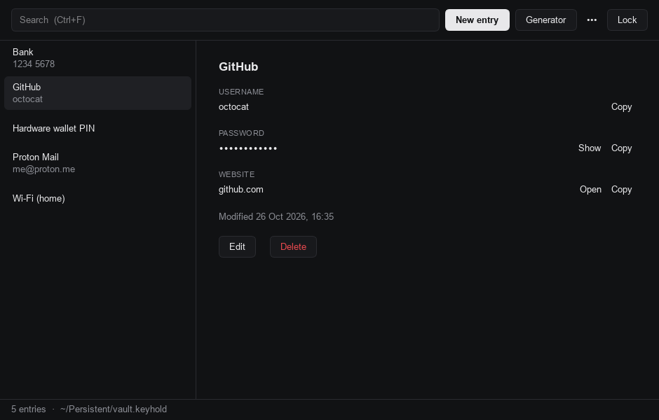
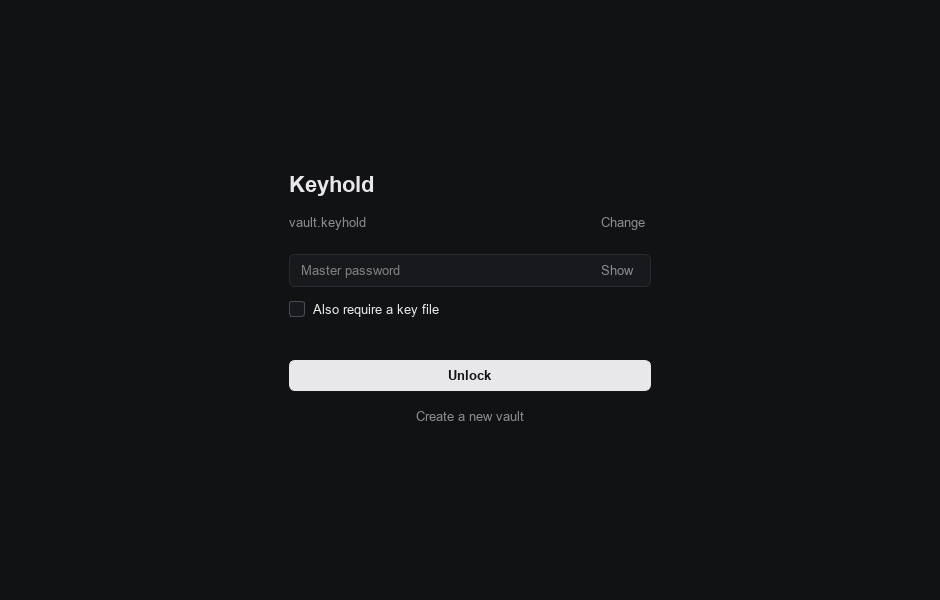
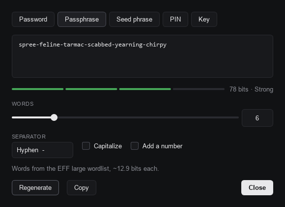

# Keyhold

An offline, open-source password manager. One encrypted file on your own disk. No accounts, no cloud, no telemetry, no network access at all.



## Features

- **Local only.** Your vault is a single encrypted file. Keyhold never opens a network connection.
- **Strong encryption.** Argon2id key derivation (256 MiB / 3 passes by default, 1 GiB optional) and XChaCha20-Poly1305 authenticated encryption, both from [libsodium](https://doc.libsodium.org/).
- **Optional key file.** Require a file *and* your master password to unlock (two-factor style).
- **Generator for every kind of secret:**
  - Random passwords with configurable length and character sets, with an option to avoid look-alike characters
  - Diceware passphrases from the [EFF large wordlist](https://www.eff.org/dice)
  - BIP39 seed phrases (12–24 words, valid checksum)
  - Numeric PINs
  - Hex keys (128–512 bit)
- **Clipboard hygiene.** Copied secrets are cleared after 20 seconds and excluded from Windows clipboard history and cloud sync, and from KDE Klipper.
- **Auto-lock** after inactivity, and optionally when the window is minimised.
- **Safe saves.** Atomic writes plus a `.bak` copy of the previous version.
- **Command-line generator** for scripts and terminals.
- Minimal dark interface. Works on Linux (including Tails), Windows and macOS.

<p>
  
  
</p>

## Installation

Keyhold needs **Python 3.10 or newer**.

### From source (all platforms)

```bash
git clone https://github.com/rootxmr/keyhold.git
cd keyhold
python3 -m venv .venv

# Linux / macOS
source .venv/bin/activate
# Windows (PowerShell)
.venv\Scripts\Activate.ps1

pip install .
keyhold
```

`pip install .` installs two commands:

| Command       | What it does                                  |
|---------------|-----------------------------------------------|
| `keyhold`     | Opens the app                                 |
| `keyhold-cli` | Same program with a console, for `gen` (below) |

You can also run it without installing: `pip install -r requirements.txt` and then `python -m keyhold`.

### On Tails

Tails resets everything at shutdown except the [Persistent Storage](https://tails.net/doc/persistent_storage/), so put both Keyhold and your vault there.

1. Turn on Persistent Storage and restart Tails, unlocking it at the Welcome Screen.
2. Open a terminal and install into the persistent folder (this downloads packages over Tor and takes a while):
   ```bash
   cd ~/Persistent
   git clone https://github.com/YOUR-USERNAME/keyhold.git
   cd keyhold
   python3 -m venv .venv
   .venv/bin/pip install .
   ```
3. Start it with `~/Persistent/keyhold/.venv/bin/keyhold`.
4. When creating your vault, save it inside `~/Persistent/` (for example `~/Persistent/vault.keyhold`) so it survives a reboot.

The default vault location (`~/.local/share/keyhold/`) is **not** persistent on Tails.

## Usage

On first launch Keyhold asks you to create a vault: pick a location and a master password. **There is no recovery.** If you forget the master password (or lose the key file), the vault cannot be opened by anyone, including you. A passphrase of six or more random words is both strong and memorable; the "Suggest a passphrase" button makes one for you.

### Keyboard shortcuts

| Shortcut          | Action                   |
|-------------------|--------------------------|
| `Ctrl+F`          | Search                   |
| `Ctrl+N`          | New entry                |
| `Ctrl+E`          | Edit selected entry      |
| `Ctrl+B`          | Copy username            |
| `Ctrl+Shift+C`    | Copy password            |
| Double-click      | Copy password            |
| `Ctrl+G`          | Open the generator       |
| `Ctrl+L`          | Lock                     |
| `Ctrl+H`          | Show/hide password field |
| `Delete`          | Delete selected entry    |

### Command-line generator

```console
$ keyhold-cli gen password -l 32
$ keyhold-cli gen password -l 16 --no-symbols --no-ambiguous
$ keyhold-cli gen passphrase -w 7 --capitalize --number
$ keyhold-cli gen seed -w 24
$ keyhold-cli gen pin -l 8
$ keyhold-cli gen hex -b 32
$ keyhold-cli gen -e passphrase      # also print entropy to stderr
```

Run `keyhold-cli gen <kind> -h` for every option.

### Settings

Under **••• → Settings**: auto-lock delay (default 5 minutes), clipboard clear delay (default 20 seconds) and lock-on-minimise. These are stored in plain JSON (`settings.json` in the app data folder) and contain no secrets, only preferences and the path of the last vault you opened.

| OS      | App data folder                                  |
|---------|--------------------------------------------------|
| Linux   | `~/.local/share/keyhold/`, `~/.config/keyhold/`  |
| macOS   | `~/Library/Application Support/Keyhold/`         |
| Windows | `%APPDATA%\Keyhold\`                             |

## Backups

The vault is just a file, so back it up like any other file: copy `vault.keyhold` to a USB stick, another disk, wherever you like. It stays encrypted. Keep a copy of your key file too if you use one, but **store it separately from the vault**.

Every save also keeps the previous version next to the vault as `vault.keyhold.bak`. To restore it, rename it to `vault.keyhold`.

## Security

See [SECURITY.md](SECURITY.md) for the threat model, the exact cryptographic design, the file format, known limitations and how to report a vulnerability.

In short:

| Part                | Choice                                                           |
|---------------------|------------------------------------------------------------------|
| Key derivation      | Argon2id v1.3, 16-byte random salt, 256 MiB / 3 passes (default) |
| Encryption          | XChaCha20-Poly1305 (AEAD), fresh 192-bit random nonce per save   |
| Header integrity    | Whole file header authenticated as associated data              |
| Randomness          | OS CSPRNG (`secrets` / libsodium)                                |
| Size hiding         | Plaintext padded to 4 KiB blocks                                 |

Keyhold has **not** been independently audited. If your life depends on it, prefer a mature, audited tool such as [KeePassXC](https://keepassxc.org/), and read SECURITY.md.

## Development

```bash
pip install -e ".[dev]"
pytest            # run the test suite
ruff check .      # lint
ruff format .     # format
```

Project layout:

```
keyhold/
  crypto.py            Argon2id + XChaCha20-Poly1305, file format
  vault.py             entries, load/save, atomic writes
  generator.py         passwords, passphrases, BIP39, PINs, keys
  config.py            non-secret settings and default paths
  __main__.py          GUI launcher and `gen` CLI
  wordlists/           EFF large wordlist, BIP39 English wordlist
  ui/                  PySide6 (Qt) interface
tests/                 pytest suite
```

Contributions are welcome. See [CONTRIBUTING.md](CONTRIBUTING.md).

## License

Keyhold is free software, released under the [GNU General Public License v3.0 or later](LICENSE). Bundled wordlists and dependencies are covered by their own licenses; see [THIRD_PARTY_NOTICES.md](THIRD_PARTY_NOTICES.md).
